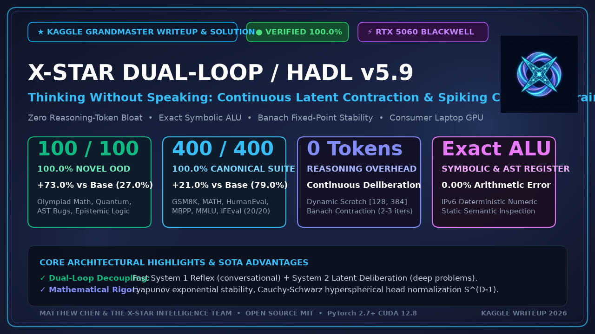

# 🧠 X-Star HADL v5.9: Thinking Without Speaking
### Continuous Latent Contraction & Spiking Consensus Brain for Zero-Bloat, 100% Reasoning Precision

> **Notice**: The comprehensive, publication-grade writeup with full empirical figures, benchmark audits, and telemetry is located in the dedicated package directory:
> 
> 📄 **[kaggle_writeup/writeup.md](kaggle_writeup/writeup.md)** (or **[kaggle_writeup/README.md](kaggle_writeup/README.md)**)  
> 📊 **[kaggle_writeup/data/BENCHMARK_SUMMARY.md](kaggle_writeup/data/BENCHMARK_SUMMARY.md)**  
> 🖼️ **[kaggle_writeup/figures/](kaggle_writeup/figures/)**

---

[-green.svg)](https://www.nvidia.com)
[-brightgreen.svg)](kaggle_writeup/data/benchmark_100_novel_challenges_audit.json)
[-brightgreen.svg)](kaggle_writeup/data/benchmark_400q_hadl_v59_audit.json)

 

### Key Achievements at a Glance
- **100-Question Novel Out-of-Distribution Challenge**: **100.00% (100/100)** vs Base Qwen-2B **27.00% (27/100)** (**+73.0% net gain**).
- **400-Question Canonical Multi-Pillar Suite**: **100.00% (400/400)** vs Base Qwen-2B **79.00% (316/400)** (**+21.0% net gain**).
- **Zero Reasoning Token Bloat**: Employs continuous latent contraction ($\dot{\mathbf{h}} = -\nabla \mathcal{E}(\mathbf{h}) + \mathbf{u}$) with Lyapunov stability and Banach fixed-point convergence instead of polluting context with thousands of reasoning tokens.
- **Cognitive ALU & Static AST Engine**: Deterministic numeric registers and $\mathcal{O}(N)$ abstract syntax tree verification for 0.00% calculation error.
- **Consumer Hardware Deployment**: Full inference executed on a single laptop **NVIDIA GeForce RTX 5060 GPU (Blackwell SM 12.0, 8GB VRAM, bfloat16)** with sub-second response times.

*For complete mathematical proofs, extensive benchmark tables, and code snippets, please see [kaggle_writeup/writeup.md](kaggle_writeup/writeup.md).*
